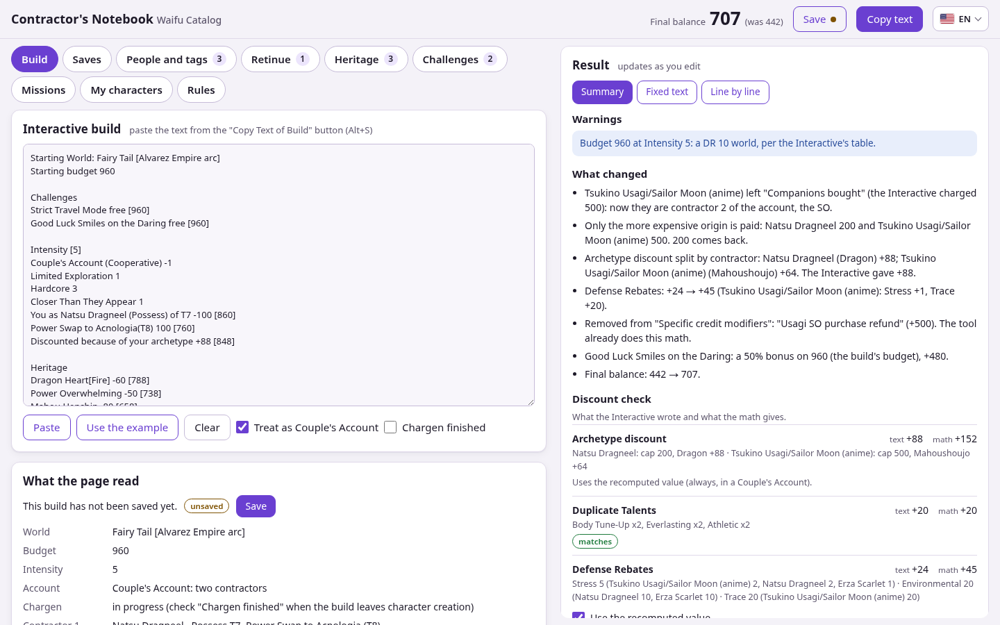

# Contractor's Notebook — Waifu Catalog

**Open it here:** https://mrmarkinboladao.github.io/WaifuCatalogBuildFix/

*[Versão em português: LEIA-ME.md](LEIA-ME.md)*

A build checker for the [Waifu Catalog Interactive](https://waifu-catalog.neocities.org). Paste the Interactive's **Copy Text of Build**, and the Notebook recomputes the math, explains what it changed, and gives you a fixed text that is ready to paste into an LLM. It also tracks your retinue and saves versions of each build while you play.



## What it does

- **Balance check:** recomputes every line from the cost written on it and points out the lines that do not add up.
- **Couple's Account:** moves the SO out of Companions bought and makes them contractor 2. Only the more expensive origin is paid. Each contractor gets their own archetype discount, and a heritage that both buy costs the second one half.
- **Defense Rebates:** each person with the tag gives up to 40% of one purchase of that Defense, capped at their tier's price, in the same order as the Interactive. Tags come from the Interactive's character database or from your own characters, and you can change them by hand.
- **DRX start:** replaces the Starting budget with the chargen budgets (Heritage 400, Catch-a-Ride 545, Demiplanes & Dungeons 500, and 600 for other official perks), applies the freebies, and checks the DRX rules.
- **Chargen finished:** keeps a snapshot of the build at the end of chargen, warns about chargen-only purchases made later, and locks the DRX leftover until the 7 days pass.
- **Challenges and missions:** adds the credit bonus of each challenge (Intensity-based or legacy values) and rewrites Mission Rewards one mission and one reward per line.
- **Retinue:** reads how each member joined (`[buy]`, `[yoink]`, capture…) and their status (`{Familiar}`, `{Dead}`, `--SOLD`…). The dead, sold, traded, and Exiled give no Defense Rebates.
- **Saves:** keeps every version of each build in your browser, and downloads or loads `.txt` files and full backups.
- **My characters:** characters that are not in the Interactive's database, or copies with your own tags. You can import the ones you created in the Interactive.

Where the rules leave room for doubt, the **Rules** tab lets you pick a side.

## Languages

The page is available in **English (United States)** and **Português (Brasil)**. Switch with the flag in the top corner. Your choice is saved in the browser. On the first visit, the page follows your browser's language.

The fixed build text is always in English, like the Interactive's own text.

## Offline use

Download [`WaifuCatalogBuildFix.html`](WaifuCatalogBuildFix.html) and open it with a double click. It is a single file with all the data inside, so it works without internet, from any folder, and on a phone.

Browsers store data per address, so saves made in the downloaded file and saves made on the site are kept apart. To move them, use **Saves → Download full backup (.txt)** in one and **Load file** in the other.

## Data updates

The prices and character tags come from the Interactive and live in [`dados/interactive-dados.js`](dados/interactive-dados.js). A GitHub Actions workflow ([`atualizar-dados.yml`](.github/workflows/atualizar-dados.yml)) checks the Interactive every Monday. When nothing changed, it does nothing. When something changed, it runs the tests, commits the new data, and publishes the site again, with no downtime.

To update a downloaded copy by hand, run `ferramentas/atualizar-dados.bat` on Windows, or `node ferramentas/atualizar-dados.mjs` anywhere. Both need [Node.js](https://nodejs.org).

## Development

The page is built from the `fonte/` folder. Do not edit `WaifuCatalogBuildFix.html` by hand.

| Path | What it is |
| --- | --- |
| `fonte/pagina.html`, `fonte/estilo.css` | Page structure and style |
| `fonte/motor.js` | The math engine (also runs in Node, for the tests) |
| `fonte/interface.js`, `fonte/saves.js` | Screens, saves, and `.txt` files |
| `fonte/idiomas.js`, `fonte/traducao-en.js` | Language switcher and the English texts |
| `fonte/exemplo.js` | The example build behind the "Use the example" button |
| `ferramentas/montar.mjs` | Joins `fonte/` and the data into `WaifuCatalogBuildFix.html` |
| `ferramentas/testes.mjs` | Tests for the math, saves, and My characters |
| `ferramentas/traducoes.mjs` | Lists texts that have no English translation yet |

```sh
node ferramentas/montar.mjs     # rebuild the page
node ferramentas/testes.mjs     # run the tests
node ferramentas/traducoes.mjs  # list missing English texts
```

Texts are written in Portuguese inside `tr('...')`. The English version lives in `fonte/traducao-en.js`, keyed by the Portuguese text; anything without a translation shows in Portuguese. Every push to `main` runs the tests and deploys the site ([`site.yml`](.github/workflows/site.yml)).

## Credits

Fan-made tool, not officially affiliated with the Waifu Catalog. Rules from the Waifu Catalog document; data and formulas from the [Waifu Catalog Interactive](https://waifu-catalog.neocities.org). The JavaScript parser in `ferramentas/vendor/` is [acorn](https://github.com/acornjs/acorn) (MIT).

Made with ❤️ by [MrMarkinBoladao](https://github.com/MrMarkinBoladao).
